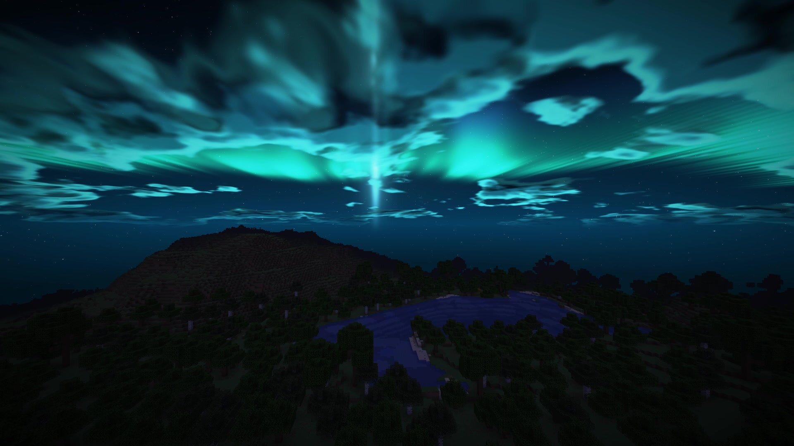
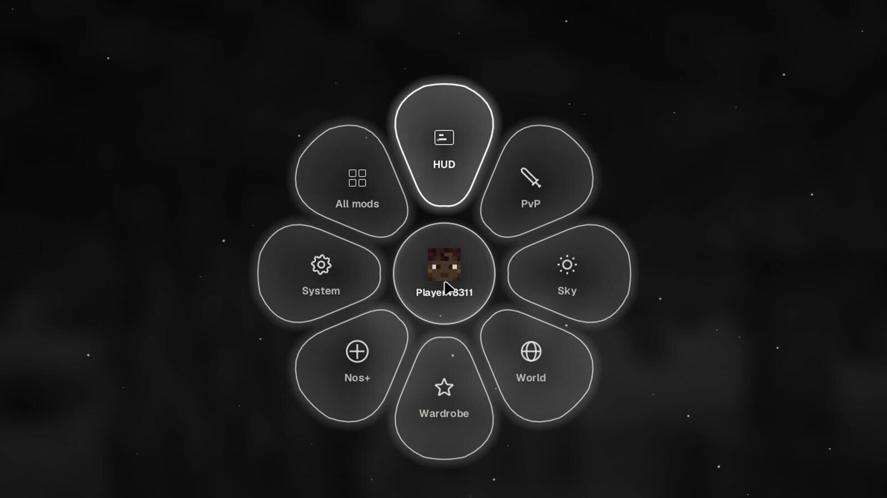
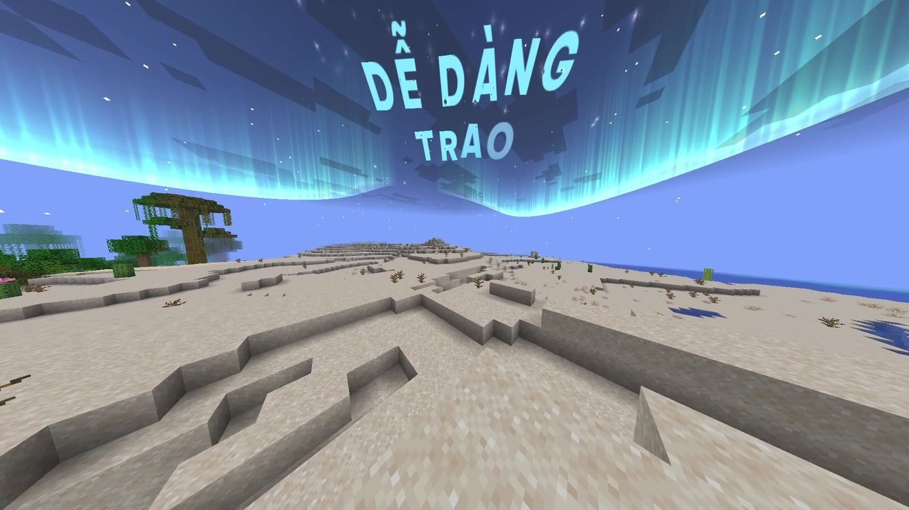
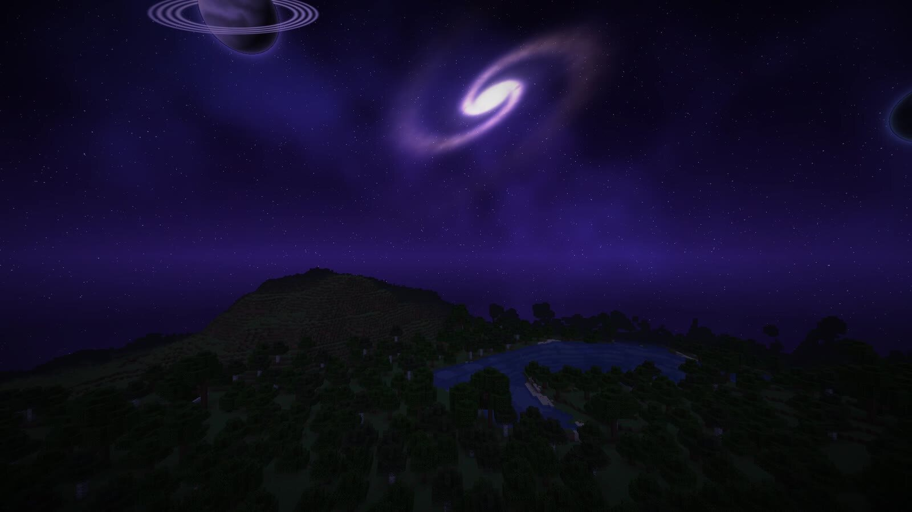
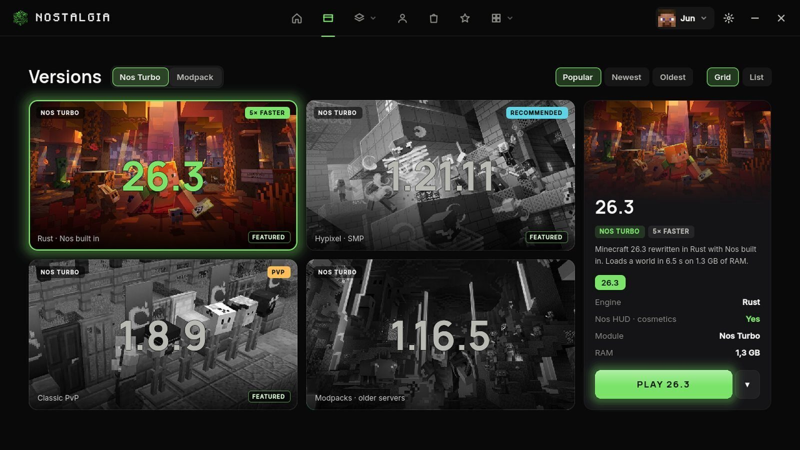

  

<h1 align="center">Nostalgia + Nos Turbo</h1>

  Minecraft 26.3 rewritten in Rust, with a mod hub, 29 live skies and cosmetics built in. 
  Free for Windows and Linux. Made in Vietnam.

  <a href="https://github.com/JunXmas/nos-releases/releases/latest"><b>Download</b></a> ·
  <a href="https://nostalgiamc.org/">Website</a> ·
  <a href="#tiếng-việt">Tiếng Việt</a> ·
  <a href="https://discord.gg/TTDqYmM89W">Discord</a>

---

## What you get

**Nos Turbo** is the game. It is Minecraft: Java Edition 26.3 rebuilt in Rust on top of
[Horizon](https://github.com/horizon-rust/horizon), so it opens a world in about 6.5 seconds and
uses about 1.3 GB of RAM in game. Nos, our client, lives inside it: nothing to install, no mod
loader.

**Nostalgia** is the launcher. One Play button opens Nos Turbo, and the same tab keeps your
Fabric, Forge, NeoForge and vanilla modpacks.

<table>
  <tr>
    <td width="50%"></td>
    <td width="50%"></td>
  </tr>
  <tr>
    <td><b>Right Shift opens the hub.</b> HUD, PvP, sky and system mods sit in one flower;
    Ctrl+K finds any of them by name.</td>
    <td><b>Your music, in the sky.</b> The song playing on your PC appears line by line in 3D
    letters above the world. Linux first, Windows next.</td>
  </tr>
  <tr>
    <td></td>
    <td></td>
  </tr>
  <tr>
    <td><b>29 skies.</b> Aurora, galaxy, black hole, sunset and more, each a shader that
    replaces the vanilla sky. Pick one in the hub.</td>
    <td><b>The launcher.</b> Microsoft, Ely.by or offline accounts, skin library, drag a
    <code>.mrpack</code> in to import it, Discord status while you play.</td>
  </tr>
</table>

### Numbers

Same PC (RTX 4050 laptop), 16-chunk render distance.

| | Nos Turbo | Minecraft Java | Java + Sodium |
|---|---:|---:|---:|
| World load | **6.5 s** | 33.3 s | 36.9 s |
| RAM in game | **1.3 GB** | 2.9 GB | 2.8 GB |
| 1% low FPS, mountains | **176** | 64 | 88 |

## Download

Get the newest release from **[Releases](https://github.com/JunXmas/nos-releases/releases/latest)**.
Releases tagged `app-v…` are the launcher; the launcher downloads Nos Turbo (`turbo-v…`) for you.

| System | File |
|---|---|
| Windows 10/11 (64-bit) | `nostalgia-<version>-windows-x64-setup.exe` |
| Ubuntu, Mint, Debian | `nostalgia_<version>_amd64.deb` |
| Fedora, openSUSE | `nostalgia-<version>-1.x86_64.rpm` |
| Any Linux | `nostalgia-<version>-linux-x64.AppImage` |

macOS is not ready yet.

**Coming from Nostalgia Launcher 1.2?** It updates itself to 2.0. Your instances, accounts and
skins are copied over the first time 2.0 opens, and the old folder is left untouched.

## Free, and Nos+

The launcher, Nos Turbo, the hub, the skies and the lyrics are free. **Nos+** (39,000₫ a month or
179,000₫ for six months) adds a badge by your name, a colour-shifting cape and Nos themes. Wings, capes,
hats and kill effects are also sold one by one in the [store](https://nostalgiamc.org/store).
Payment is a bank transfer through payOS.

## Safety

- Download only from this page or [nostalgiamc.org](https://nostalgiamc.org/). A re-upload
  anywhere else is not ours.
- Every release has `SHA256SUMS` signed with our release key; the launcher checks the signature
  before it installs or updates anything. How to check it yourself, and every server the apps
  talk to: [AN-TOAN.md](AN-TOAN.md).
- Found a security problem? See [SECURITY.md](SECURITY.md).

## Good to know

- **Hypixel:** Hypixel has not approved Nos in writing. We played a month without a ban, but the
  risk is yours.
- **Servers:** Nos Turbo runs 26.3. Support for older servers (1.21.11, 1.8.9, 1.16.5) is coming.
- **Mods:** Nos Turbo does not run Fabric or Forge mods. For mods, make a modpack in the launcher.

## Licence

Nostalgia and Nos are © 2026 JunXmas, all rights reserved: free to download and use, not to
redistribute or modify ([LICENSE](LICENSE)). Nos Turbo is built on Horizon, © 2026 Ludovic Marie
and the Horizon contributors, MIT licence; that licence and the other third-party notices ship
inside every Nos Turbo download. Not affiliated with Mojang or Microsoft. Minecraft is a trademark
of Mojang AB.

---

## Tiếng Việt

**Nos Turbo** là Minecraft 26.3 viết lại bằng Rust (dựa trên Horizon). Vào thế giới khoảng 6,5
giây, ăn khoảng 1,3 GB RAM. Nos dựng sẵn bên trong: không cài mod, không cần Fabric.

**Nostalgia** là launcher: một nút CHƠI mở Nos Turbo, cùng trang đó giữ các modpack Fabric, Forge,
NeoForge và vanilla của bạn.

- **Right Shift mở hub.** Mod HUD, PvP, bầu trời và hệ thống xếp thành một bông hoa; Ctrl+K tìm
  mod theo tên.
- **Lời bài hát trên trời.** Bài đang phát trên máy hiện từng dòng bằng chữ 3D phía trên thế giới
  (Linux trước, Windows sau).
- **29 bầu trời:** cực quang, thiên hà, hố đen, hoàng hôn... chọn trong hub.
- **Launcher:** tài khoản Microsoft, Ely.by hoặc offline, thư viện skin, kéo thả `.mrpack` để
  nhập, hiện trạng thái trên Discord.

**Tải:** vào [Releases](https://github.com/JunXmas/nos-releases/releases/latest). Windows chọn
`...-windows-x64-setup.exe`; Ubuntu/Mint chọn `.deb`; Linux khác chọn `.AppImage`. Chưa có bản
macOS.

**Đang dùng Nostalgia Launcher 1.2?** Launcher tự cập nhật lên 2.0. Lần đầu mở, bản 2.0 chép bản
chơi, tài khoản và skin sang; thư mục cũ giữ nguyên.

**Miễn phí và Nos+:** launcher, Nos Turbo, hub, bầu trời, lời bài hát đều miễn phí. Nos+ (39.000đ
một tháng hoặc 179.000đ sáu tháng) thêm huy hiệu cạnh tên, áo choàng đổi màu và theme Nos. Cánh, áo
choàng, mũ và kill effect bán lẻ ở [cửa hàng](https://nostalgiamc.org/store-vi). Thanh toán chuyển
khoản qua payOS.

**An toàn:** chỉ tải ở trang này hoặc nostalgiamc.org. Mỗi bản có `SHA256SUMS` ký bằng khoá phát
hành, launcher kiểm chữ ký trước khi cài hay cập nhật. Cách tự kiểm và danh sách máy chủ app kết
nối: [AN-TOAN.md](AN-TOAN.md).

**Hypixel:** Hypixel chưa duyệt Nos bằng văn bản. Chúng tôi chơi một tháng không bị ban, nhưng
rủi ro do bạn chịu.
